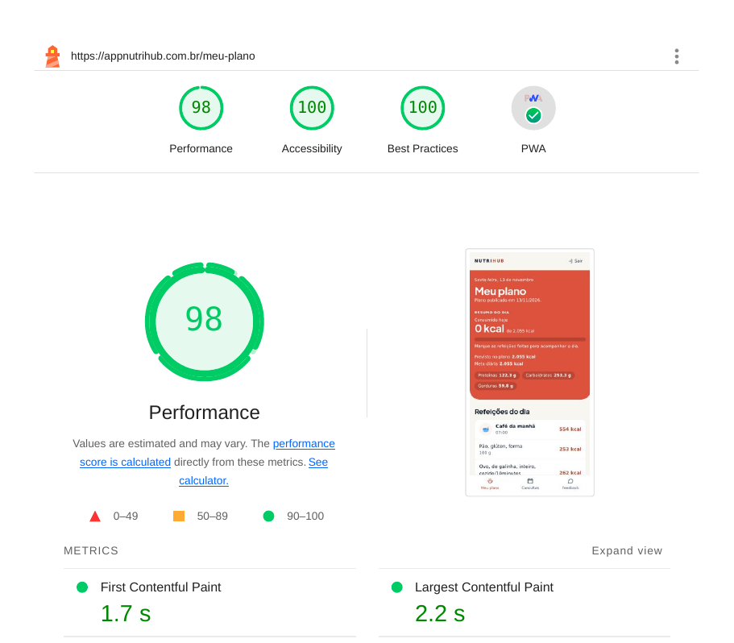
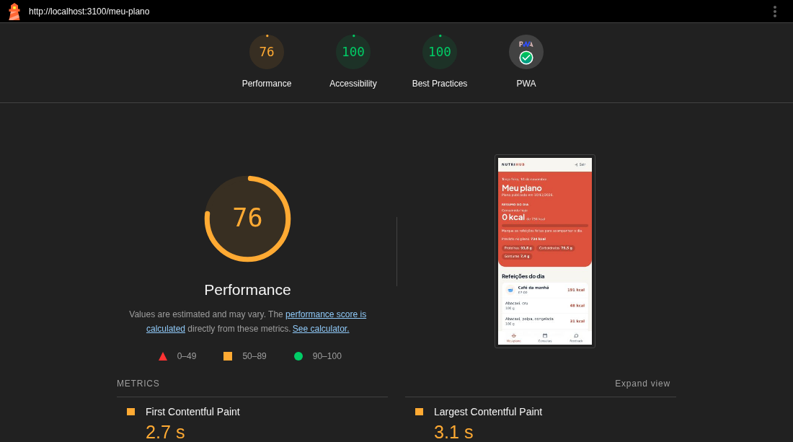
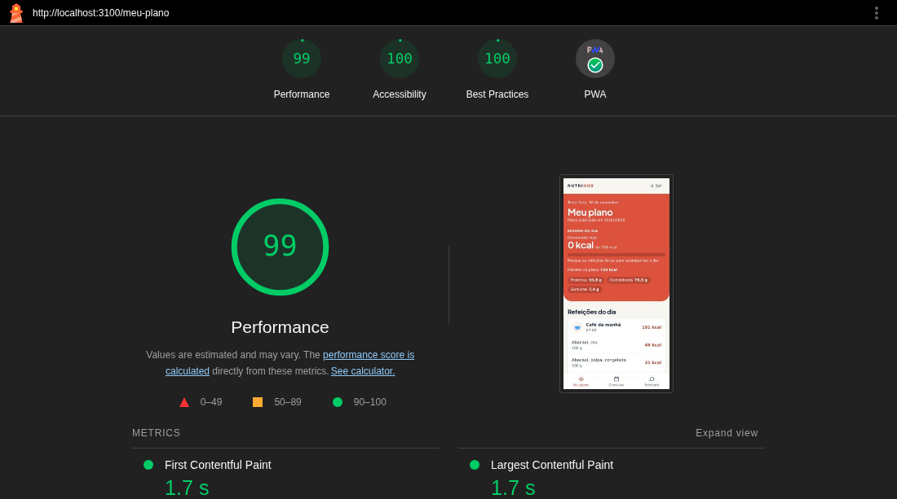
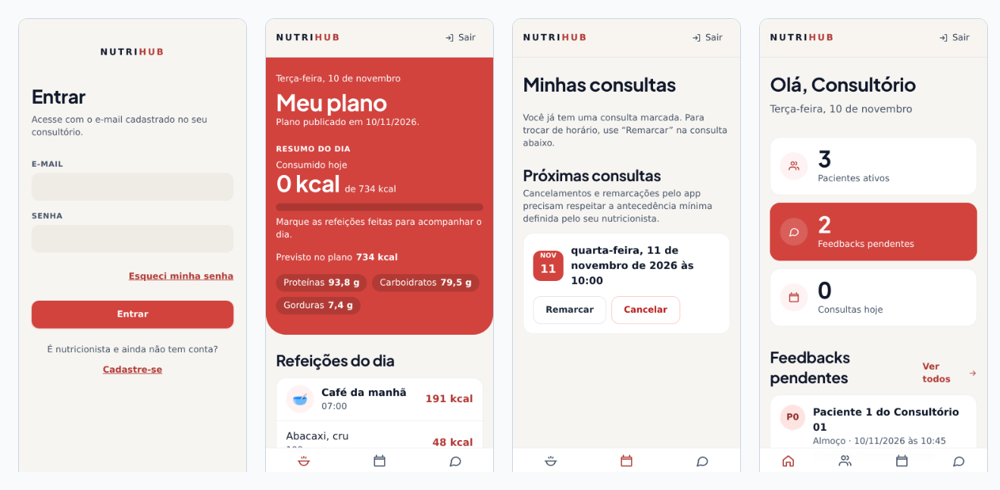

# Lighthouse do Nutri-Hub: resultados

**Ferramenta:** Google Lighthouse 11.7.1, perfil de celular com **4G simulado**. São as condições padrão do Lighthouse, que correspondem a um 4G lento: 150 ms de latência e 1,6 Mbit/s.
**Medição:** sempre como **primeiro acesso**, sem cache e sem o service worker do PWA, que é o pior caso. Cada tela foi medida **5 vezes**, e vale a mediana, como o próprio Google recomenda, porque o Lighthouse varia de uma rodada para outra.

Foram feitas duas rodadas de medição:
- **Produção, em 13/11/2026:** https://appnutrihub.com.br, no App Service da Azure na região Chile Central, com dados reais (um consultório, pacientes e um plano publicado). **É a medição que vale.**
- **Ambiente local, em 10/11/2026:** o mesmo pacote do app, rodando na máquina de desenvolvimento enquanto a Azure estava pausada. Ela encontrou os primeiros problemas (seção 2), mas não tem a distância real até o servidor.

Os requisitos verificados:

| Requisito | O que pede | Resultado em produção |
|---|---|---|
| **RNF-04** | Plano alimentar do paciente carrega em menos de 2 s em 4G (medido via Lighthouse) | ⚠️ A tela aparece em **1,7 s**, e o plano completo em **2,2 s**, no 4G lento do Lighthouse. Desempenho **98**. Detalhes na seção 1 |
| **RNF-07** | Interface do paciente funcional em telas a partir de 360 px; app instalável como PWA | ✅ 21 telas sem rolagem horizontal em 360 px; PWA aprovado em todas as telas |
| **RNF-08** | Acessibilidade, contraste e elementos clicáveis de no mínimo 44 x 44 px | ✅ Acessibilidade **100** em todas as telas, incluindo o contraste de cores; todos os elementos clicáveis com 44 x 44 px ou mais |

## 1. Notas por tela, em produção

Mediana de 5 rodadas, em 13/11/2026, celular, 4G simulado, primeiro acesso:

| Tela | Desempenho | Acessibilidade | Boas práticas | PWA | Primeiro conteúdo (FCP) | Maior conteúdo (LCP) | Tela pulando (CLS) |
|---|---|---|---|---|---|---|---|
| Login | 98 | 100 | 100 | ✅ | 1,8 s | 2,1 s | 0 |
| **Paciente: Meu plano (RNF-04)** | **98** | **100** | **100** | ✅ | **1,7 s** | **2,2 s** | **0** |
| Paciente: Minhas consultas | 95 | 100 | 100 | ✅ | 1,8 s | 2,8 s | 0,037 |
| Nutricionista: Painel | 98 | 100 | 100 | ✅ | 1,7 s | 2,1 s | 0,007 |
| Nutricionista: Pacientes | 98 | 100 | 100 | ✅ | 1,7 s | 2,1 s | 0 |

As 5 rodadas do Meu plano deram LCP de 2,4 s, 2,2 s, 2,2 s, 2,2 s e 2,2 s. Acessibilidade, boas práticas e PWA deram 100 em todas as 25 medições.

**Como ler:**
- **FCP (First Contentful Paint)** é quando a tela começa a aparecer. No Meu plano, são o topo e o esqueleto do resumo.
- **LCP (Largest Contentful Paint)** é quando o maior elemento da tela aparece, a métrica do Lighthouse que corresponde a "a tela carregou". No Meu plano, é a lista de refeições, que depende do plano vindo da API.
- **CLS (Cumulative Layout Shift)** mede quanto a tela "pula" enquanto carrega. Abaixo de 0,1 é considerado bom.

**Sobre o RNF-04.** Em produção, o Meu plano fica em 2,2 s no perfil de 4G lento do Lighthouse, 0,2 s acima da meta. Na rede local, sem a distância até o servidor, dava 1,7 s. A diferença vem da latência real até a região do Chile, de cerca de 70 ms por viagem de ida e volta. O servidor não é o gargalo: ele responde o plano em cerca de 25 ms.

O que ainda separa os 2,2 s dos 1,7 s da primeira pintura é o tempo de baixar e executar o JavaScript do app, de 87 KB comprimido, antes de desenhar a lista. A divisão do JavaScript por tela já foi testada e piorou o resultado (seção 2). O perfil de 1,6 Mbit/s é mais lento que o 4G típico: numa rede 4G comum, mais rápida, o tempo cai.

### Correções feitas a partir da medição em produção

| Problema apontado | Causa | Correção | Efeito no Meu plano |
|---|---|---|---|
| Script bloqueando a primeira pintura (`render-blocking-resources`) | O `registerSW.js` do PWA entrava no `<head>` sem `defer` | `injectRegister: 'script-defer'` no `vite-plugin-pwa` | Primeira pintura de **2,1 s para 1,7 s** |
| A tela "pulava" ao carregar (CLS de 0,419) | O botão do WhatsApp aparecia durante o carregamento e era empurrado para fora da tela. Previsto e meta quebravam de linha com os números reais, e o esqueleto reservava só uma | O botão só entra depois do plano. Previsto e meta ficam sempre empilhados, e o esqueleto reserva as duas linhas | CLS de **0,419 para 0**; desempenho de **77 para 95** |
| Lista de refeições esperando uma cadeia de pedidos | O pedido do plano só saía depois de o JavaScript chegar e executar | O `index.html` já pede o plano do paciente em paralelo com o JavaScript, e o app usa essa resposta | LCP de **2,8 s para 2,2 s**; desempenho de **95 para 98** |

## 2. Medição local, em 10/11/2026

A primeira medição, na máquina de desenvolvimento, reprovava o RNF-04: **o Meu plano levava 3,1 s** no primeiro acesso em 4G.

| Problema apontado | Causa | Correção | Efeito |
|---|---|---|---|
| Arquivos sem compressão (`uses-text-compression`) | O Express mandava o JavaScript e o CSS do app sem compactar, e o App Service não comprime sozinho | Compressão gzip em todas as respostas da API (`compression`, o middleware oficial do Express) | O JavaScript do app caiu de **287 KB para 86 KB** no download |
| A tela "pulava" ao carregar (CLS de 0,257) | O resumo do dia, no topo do Meu plano, só entrava depois de o plano chegar, e empurrava a tela inteira cerca de 290 px para baixo | Enquanto o plano carrega, um esqueleto com as mesmas alturas reserva o lugar do resumo | CLS de **0,257 para 0** |
| Links com área de toque pequena (RNF-08) | "Esqueci minha senha", "Cadastre-se" e os outros links no meio do texto das telas de entrada tinham 16 px de altura, e o nome do paciente na agenda tinha 43 px | Área de toque de 44 x 44 px nesses links, sem mudar a aparência do texto | Todos os elementos clicáveis com 44 px ou mais |

**Resultado no Meu plano, na medição local:** o LCP foi de **3,1 s para 1,7 s**, e o desempenho de **76 para 99**.

| Tela (local) | Desempenho | FCP | LCP | CLS |
|---|---|---|---|---|
| Login | 99 | 1,7 s | 1,8 s | 0 |
| Paciente: Meu plano | 99 | 1,7 s | 1,7 s | 0 |
| Paciente: Minhas consultas | 98 | 1,7 s | 2,1 s | 0 |
| Nutricionista: Painel | 99 | 1,7 s | 1,7 s | 0,03 |
| Nutricionista: Pacientes | 99 | 1,7 s | 2,0 s | 0 |

**Tentativa descartada:** dividir o JavaScript em um arquivo por tela (*code splitting*). O pacote principal ficou menor, mas o navegador passou a precisar de mais uma viagem pela rede antes de mostrar a tela. Em 4G isso **piorou** o Meu plano de 1,7 s para 3,0 s, e a mudança foi desfeita.

## 3. Telas em 360 px (RNF-07) e área de toque (RNF-08)

O Lighthouse não mede a área de toque nesse perfil, e mede a tela com 412 px de largura. Por isso, um script à parte abriu **21 telas** do app num celular de 360 px de largura, a menor pedida pelo RNF-07: as de entrada e cadastro, todas as do paciente e todas as do nutricionista, incluindo o construtor de planos. Em cada uma, mediu todos os elementos clicáveis.

- **Nenhuma tela tem rolagem horizontal** em 360 px.
- **Todos os elementos clicáveis têm pelo menos 44 x 44 px.** A única exceção aparente são os botões de opção escondidos de propósito, com 1 x 1 px, nas telas de feedback. Neles, a pessoa toca o cartão em volta, que tem 44 px ou mais.

## 4. PWA (RNF-07)

A categoria PWA do Lighthouse passou em todas as telas. As verificações automáticas:

- manifesto e service worker que cumprem os requisitos de instalação;
- tela de abertura própria;
- cor do tema na barra do navegador;
- ícone adaptável (*maskable*);
- conteúdo do tamanho da tela;
- `meta viewport` configurado.

O app também foi instalado de verdade num iPhone 16e pelo Safari ("Adicionar à Tela de Início").

## 5. Observações

- **Por que a medição local deu menos que a de produção:** o 4G simulado limita a velocidade da rede, mas o Lighthouse calcula as viagens de ida e volta a partir do que mede. Na máquina local, a API respondia na hora. Em produção, cada viagem até o Chile leva cerca de 70 ms, e o Meu plano depende de algumas delas em sequência.
- **"Error!" em alguns diagnósticos do relatório completo:** são auditorias auxiliares que o Lighthouse não consegue calcular no modo de rede simulada, como "elemento do LCP". Não são falhas do app, e não entram nas notas.
- **Relatórios completos, em PDF:**
  - [Login](relatorios/entrar.pdf)
  - [Paciente: Meu plano](relatorios/paciente-meu-plano.pdf)
  - [Paciente: Minhas consultas](relatorios/paciente-consultas.pdf)
  - [Nutricionista: Painel](relatorios/nutri-painel.pdf)
  - [Nutricionista: Pacientes](relatorios/nutri-pacientes.pdf)
  - [Meu plano antes das correções, medição local](relatorios/antes-paciente-meu-plano.pdf)
- **Para conferir na hora:** o PageSpeed Insights do Google roda o mesmo Lighthouse na tela de login, que é pública: https://pagespeed.web.dev/analysis?url=https%3A%2F%2Fappnutrihub.com.br%2Fentrar
