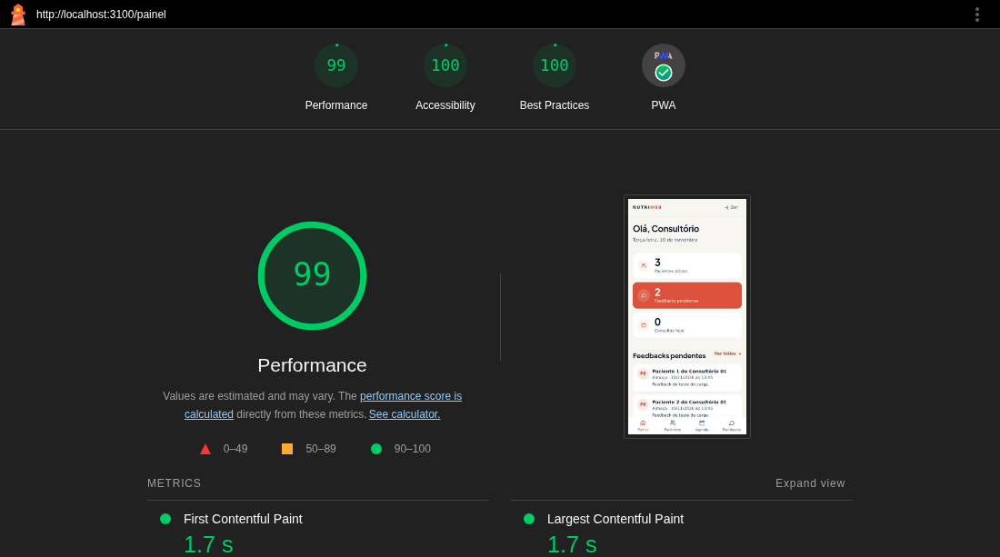
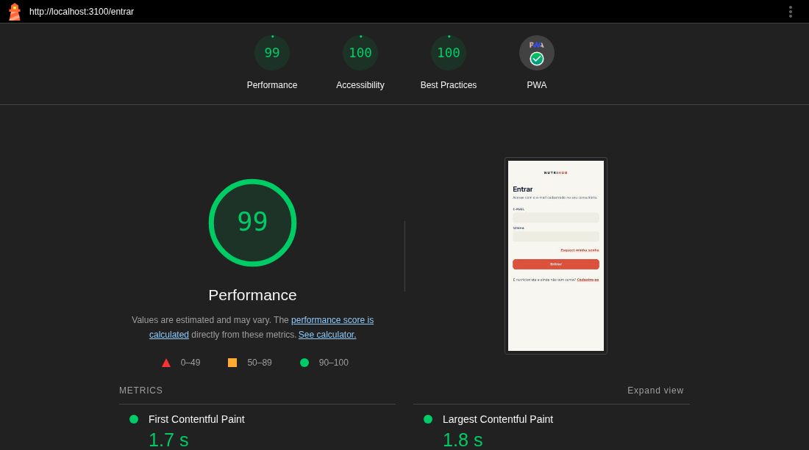

# Lighthouse do Nutri-Hub: resultados

**Data:** 10/11/2026
**Ferramenta:** Google Lighthouse 11.7.1, perfil de celular com **4G simulado** (as condições padrão do Lighthouse: 150 ms de latência e 1,6 Mbit/s).
**Ambiente:** o app montado como em produção (frontend compilado e servido pela própria API, igual ao App Service), rodando na máquina de desenvolvimento, com um consultório fictício, 3 pacientes e plano ativo.
**Medição:** sempre como **primeiro acesso**, sem cache e sem o service worker do PWA, que é o pior caso. Cada tela foi medida **5 vezes**, e vale a mediana, como o próprio Google recomenda, porque o Lighthouse varia de uma rodada para outra.

Os requisitos verificados:

| Requisito | O que pede | Resultado |
|---|---|---|
| **RNF-04** | Plano alimentar do paciente carrega em menos de 2 s em 4G (medido via Lighthouse) | ✅ **1,7 s** (mediana) |
| **RNF-07** | Interface do paciente funcional em telas a partir de 360 px; app instalável como PWA | ✅ 21 telas sem rolagem horizontal em 360 px; PWA 100 |
| **RNF-08** | Acessibilidade, contraste e elementos clicáveis de no mínimo 44 x 44 px | ✅ Acessibilidade **100** em todas as telas, incluindo o contraste de cores; todos os elementos clicáveis com 44 x 44 px ou mais |

## 1. Notas por tela

Mediana de 5 rodadas, celular, 4G simulado, primeiro acesso:

| Tela | Desempenho | Acessibilidade | Boas práticas | PWA | Primeiro conteúdo (FCP) | Maior conteúdo (LCP) | Tela pulando (CLS) |
|---|---|---|---|---|---|---|---|
| Login | 99 | 100 | 100 | ✅ | 1,7 s | 1,8 s | 0 |
| **Paciente: Meu plano (RNF-04)** | **99** | **100** | **100** | ✅ | **1,7 s** | **1,7 s** | **0** |
| Paciente: Minhas consultas | 98 | 100 | 100 | ✅ | 1,7 s | 2,1 s | 0 |
| Nutricionista: Painel | 99 | 100 | 100 | ✅ | 1,7 s | 1,7 s | 0,03 |
| Nutricionista: Pacientes | 99 | 100 | 100 | ✅ | 1,7 s | 2,0 s | 0 |

As 5 rodadas do Meu plano deram LCP de 1,7 s, 2,0 s, 1,7 s, 1,7 s e 2,1 s. Acessibilidade, boas práticas e PWA deram 100 em todas as 25 medições.

**Como ler:**
- **LCP (Largest Contentful Paint)** é quando o maior elemento da tela aparece. É a métrica do Lighthouse que corresponde a "a tela carregou". No Meu plano, é o topo com o resumo do dia.
- **CLS (Cumulative Layout Shift)** mede quanto a tela "pula" enquanto carrega. Abaixo de 0,1 é considerado bom.

## 2. O que o Lighthouse encontrou e foi corrigido

A primeira medição reprovava o RNF-04: **o Meu plano levava 3,1 s** no primeiro acesso em 4G.

| Problema apontado | Causa | Correção | Efeito |
|---|---|---|---|
| Arquivos sem compressão (`uses-text-compression`) | O Express mandava o JavaScript e o CSS do app sem compactar, e o App Service não comprime sozinho | Compressão gzip em todas as respostas da API (`compression`, o middleware oficial do Express) | O JavaScript do app caiu de **287 KB para 86 KB** no download |
| A tela "pulava" ao carregar (CLS de 0,257) | O resumo do dia, no topo do Meu plano, só entrava depois de o plano chegar, e empurrava a tela inteira cerca de 290 px para baixo | Enquanto o plano carrega, um esqueleto com as mesmas alturas reserva o lugar do resumo | CLS de **0,257 para 0** |
| Links com área de toque pequena (RNF-08) | "Esqueci minha senha", "Cadastre-se" e os outros links no meio do texto das telas de entrada tinham 16 px de altura, e o nome do paciente na agenda tinha 43 px | Área de toque de 44 x 44 px nesses links, sem mudar a aparência do texto | Todos os elementos clicáveis com 44 px ou mais |

**Resultado no Meu plano:** o LCP foi de **3,1 s para 1,7 s**, e o desempenho de **76 para 99**.

**Tentativa descartada:** dividir o JavaScript em um arquivo por tela (*code splitting*). O pacote principal ficou menor, mas o navegador passou a precisar de mais uma viagem pela rede antes de mostrar a tela. Em 4G isso **piorou** o Meu plano de 1,7 s para 3,0 s, e a mudança foi desfeita.

## 3. Telas em 360 px (RNF-07) e área de toque (RNF-08)

O Lighthouse não mede a área de toque nesse perfil, e mede a tela com 412 px de largura. Por isso, um script à parte abriu **21 telas** do app num celular de 360 px de largura, a menor pedida pelo RNF-07: as de entrada e cadastro, todas as do paciente e todas as do nutricionista, incluindo o construtor de planos. Em cada uma, mediu todos os elementos clicáveis.

- **Nenhuma tela tem rolagem horizontal** em 360 px.
- **Todos os elementos clicáveis têm pelo menos 44 x 44 px.** A única exceção aparente são os botões de opção escondidos de propósito, com 1 x 1 px, nas telas de feedback. Neles, a pessoa toca o cartão em volta, que tem 44 px ou mais.

## 4. PWA (RNF-07)

A categoria PWA do Lighthouse passou em todas as telas. As verificações automáticas:

- manifesto e service worker que cumprem os requisitos de instalação;
- tela de abertura própria;
- cor do tema na barra do navegador;
- ícone adaptável (*maskable*);
- conteúdo do tamanho da tela;
- `meta viewport` configurado.

O app também foi instalado de verdade num iPhone 16e pelo Safari ("Adicionar à Tela de Início").

## 5. Observações

- **Por que medir na máquina de desenvolvimento:** neste momento, o app na Azure está pausado para economizar créditos. O app medido é o mesmo pacote que vai para o App Service. O 4G simulado do Lighthouse limita a rede do mesmo jeito em qualquer máquina; o que muda na Azure é o tempo de resposta do servidor, de algumas dezenas de milissegundos. Quando o app voltar ao ar, a medição pode ser repetida em https://appnutrihub.com.br.
- **"Error!" em alguns diagnósticos do relatório completo:** são auditorias auxiliares que o Lighthouse não consegue calcular no modo de rede simulada, como "elemento do LCP". Não são falhas do app, e não entram nas notas.
- **Relatórios completos:** estão em `docs/lighthouse/relatorios/` (abrem no navegador). Há um por tela, mais o Meu plano antes das correções.
