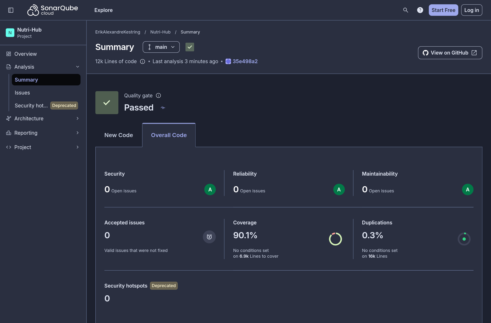

# SonarCloud do Nutri-Hub: resultados

**Data:** 13/11/2026, última análise da branch `main`.
**Ferramenta:** [SonarCloud](https://sonarcloud.io/summary/overall?id=ErikAlexandreKestring_NutriHub), análise estática de código. O painel é público.
**Como roda:** o workflow `.github/workflows/sonarcloud.yml` roda a cada pull request e a cada merge na `main`. Ele executa os testes do backend e do frontend com cobertura e manda o código e os relatórios de cobertura para o SonarCloud. A configuração está em `sonar-project.properties`.

## 1. Resultado

**Quality Gate: APROVADO.**

| Indicador | Resultado | Nota |
|---|---|---|
| Bugs (confiabilidade) | **0** | **A** |
| Vulnerabilidades (segurança) | **0** | **A** |
| Code smells (manutenibilidade) | **0** | **A** |
| Security hotspots | **0**, 100% revisados | **A** |
| Dívida técnica estimada | **0 min** | |
| Cobertura de testes | **90,1%** (linhas 90,4%, ramificações 88,9%) | |
| Código duplicado | **0,3%** | |
| Tamanho | 11.947 linhas de código em 201 arquivos | |

**Cobertura por parte do projeto:**

| Parte | Linhas de código | Cobertura |
|---|---|---|
| Backend (`backend/src`) | 5.747 | 79,0% |
| Frontend (`frontend/src`) | 6.200 | 95,0% |

A cobertura do backend junta os testes unitários e os de integração, que rodam contra um PostgreSQL de verdade. Ficam fora da conta as migrations, o seed da TACO e os arquivos de inicialização, que não têm lógica para testar.

## 2. Critérios do Quality Gate

O Quality Gate padrão do SonarCloud avalia o **código novo** de cada pull request. Um PR que não passa aparece reprovado no GitHub.

| Condição | Limite | Resultado |
|---|---|---|
| Nota de confiabilidade | A | A ✅ |
| Nota de segurança | A | A ✅ |
| Nota de manutenibilidade | A | A ✅ |
| Cobertura do código novo | pelo menos 80% | 100% ✅ |
| Duplicação no código novo | no máximo 3% | 0% ✅ |
| Security hotspots revisados | 100% | 100% ✅ |

## 3. O que o SonarCloud encontrou e foi corrigido

Na primeira análise, o SonarCloud apontou três problemas, corrigidos nos PRs #61 e #62:

| Problema | Onde | Correção |
|---|---|---|
| **Risco de ReDoS:** a expressão regular de validação de e-mail podia levar segundos para recusar um texto malicioso | Validação de e-mail no backend e no frontend | Expressão nova, sem retrocesso exponencial. Um texto de 100 KB ia de **4,9 s para 1 ms**. Testes novos cobrem o caso |
| **Expressão regular lenta** ao tirar a barra do fim de uma URL | `backend/src/config/env.ts` e o script do teste de carga | Troca por um laço simples |
| **Promise sem tratamento no Express:** um erro inesperado no middleware de autenticação não chegava ao tratador de erros | `backend/src/middlewares/authenticate.ts` | O middleware passa qualquer erro para o `next`, e um teste cobre o caso |

Depois das correções, o projeto ficou com zero bugs, zero vulnerabilidades e zero code smells.
