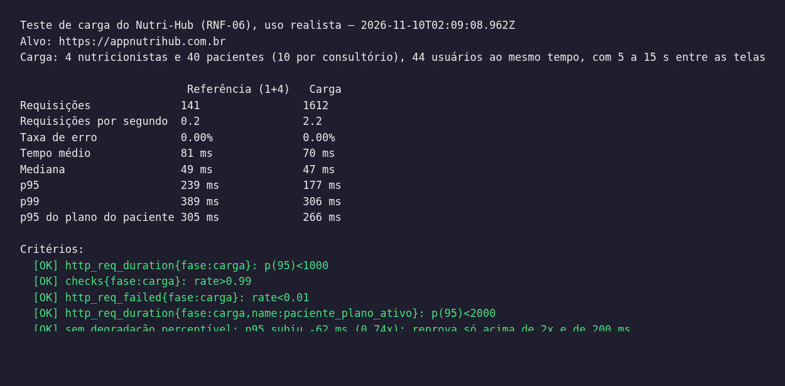
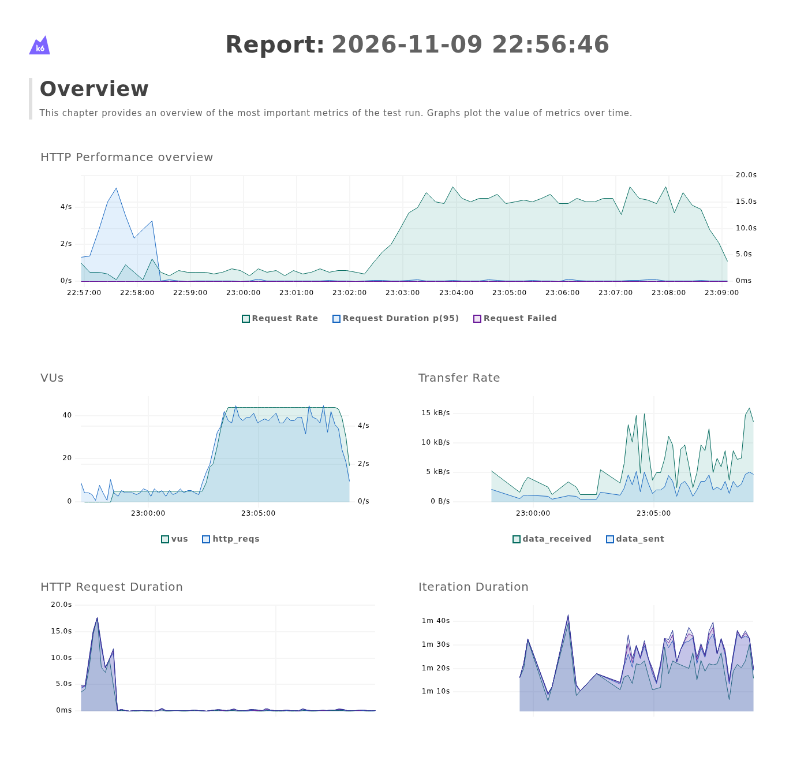
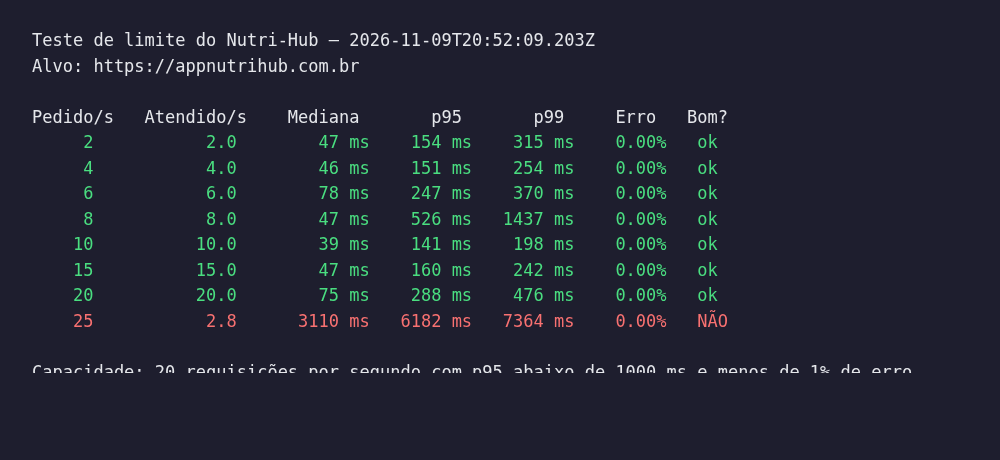
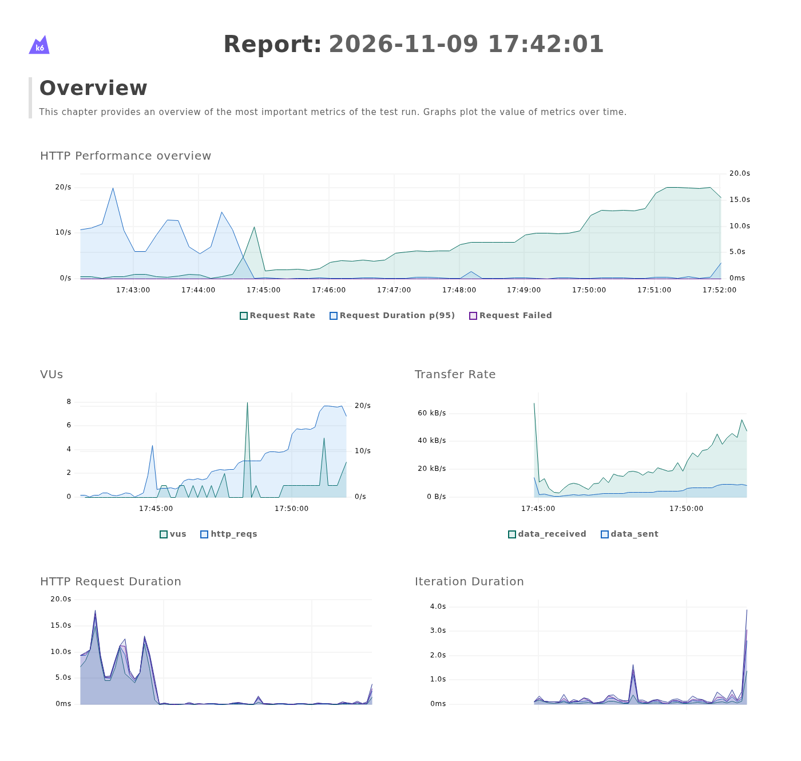

# Teste de carga do Nutri-Hub: resultados

**Data:** 09/11/2026
**Ambiente:** produção, https://appnutrihub.com.br. Azure App Service B1 (1 vCPU) e PostgreSQL Flexible Server B1ms.
**Ferramenta:** [k6](https://k6.io) v1.0. Os scripts estão em `backend/carga/`, e o passo a passo em `backend/carga/README.md`.

Foram feitos dois testes:

| Teste | Pergunta | Resultado |
|---|---|---|
| **1. Carga (RNF-06)** | 4 nutricionistas e 40 pacientes usando o app ao mesmo tempo continuam com respostas rápidas? | **APROVADO** |
| **2. Limite** | Até quantas requisições por segundo o servidor responde bem? | **20 requisições por segundo** |

## 1. Teste de carga

### Como foi feito

- **Massa de teste:** 4 consultórios fictícios, cada um com 10 pacientes com plano alimentar ativo. Esse é o tamanho combinado com o professor para esta etapa.
- **Comportamento dos usuários:** cada usuário virtual navega pelo app como uma pessoa, abrindo uma tela, levando de 5 a 15 s para ler e abrindo a próxima.
  - **Nutricionista:** lista de pacientes, ficha, planos, plano, feedbacks, agenda, busca na Tabela TACO, NPS e grade de atendimento.
  - **Paciente:** plano do dia, marca e desmarca uma refeição, contato do nutricionista, consultas, horários livres, NPS e lembrete.
- **Duas fases:**

| Fase | Duração | Usuários ao mesmo tempo |
|---|---|---|
| Referência (sistema quase vazio) | 4 min | 1 nutricionista e 4 pacientes |
| Carga | 6 min e 30 s | **4 nutricionistas e 40 pacientes (44 usuários)** |

### Resultado

| Critério | Meta | Medido | |
|---|---|---|---|
| Taxa de erro | menos de 1% | **0%** (1.612 requisições) | ✅ |
| Tempo de resposta (p95) | menos de 1 s | **177 ms** | ✅ |
| Abrir o plano do paciente (p95) | menos de 2 s (KPI da seção 1.6 do RFC) | **266 ms** | ✅ |
| Degradação em relação ao sistema quase vazio | sem degradação perceptível | **nenhuma**: o p95 foi de 239 ms para 177 ms | ✅ |

**Como ler o p95:** é o tempo dentro do qual saíram 95% das respostas. Com os 44 usuários, 95% das telas responderam em menos de 0,18 s, e a resposta típica (mediana) levou 47 ms.

### Gráficos

- **Request Rate (verde):** as requisições por segundo. É baixa durante a referência e sobe para 4 a 5 por segundo quando os 44 usuários entram, a partir de 23:02.
- **Request Duration p95 (azul):** fica perto de zero durante todo o teste, sem subir com a carga.
- **O pico no começo, até 22:58, não faz parte da medição.** É o login dos 44 usuários, feito antes do teste começar. O login usa bcrypt de custo 12 (RNF-02), que é lento de propósito para dificultar ataques de força bruta. No servidor B1, vários logins ao mesmo tempo disputam a única CPU, e alguns demoram alguns segundos. No uso real, cada pessoa faz login uma vez a cada 8 horas (nutricionista) ou 24 horas (paciente).

## 2. Teste de limite

### Como foi feito

- **A carga sobe em degraus de requisições por segundo:** 2, 4, 6, 8, 10, 15, 20, 25, 30 e 40. Cada degrau dura 1 minuto.
- **Cada requisição é uma tela do app**, sorteada entre as mesmas telas do teste de carga.
- **A capacidade** é o maior degrau em que o servidor atendeu pelo menos 95% das requisições, com p95 abaixo de 1 s e menos de 1% de erro.
- **O teste para sozinho** quando o p95 de um degrau passa de 5 s, para não deixar o site lento mais do que o necessário.

### Resultado

- **Até 20 requisições por segundo,** o servidor atendeu tudo, com p95 abaixo de 300 ms e **0% de erro**.
- **No degrau de 25,** o tempo de resposta subiu para mais de 6 s, e o teste parou ali. Mesmo saturado, o servidor não devolveu erro: as requisições só ficaram lentas.
- **O 526 ms do degrau de 8** é uma oscilação isolada. Os degraus seguintes voltaram para cerca de 150 ms.

### Gráficos

- **Request Rate (verde):** os degraus subindo de 17:45 até 17:52.
- **O pico no começo, até 17:45,** é o login antes do teste, fora da medição, como no teste de carga.

## Conclusão

1. **Com 4 consultórios e 40 pacientes usando o app ao mesmo tempo, o sistema não degradou:**
   - 0% de erro;
   - 95% das respostas em menos de 0,18 s;
   - o plano do paciente abriu em menos de 0,27 s, bem abaixo da meta de 2 s do RFC.
2. **Esse uso gerou cerca de 4,5 requisições por segundo, e o servidor atual aguenta 20.** Sobra uma margem de mais de 4 vezes.
3. **Quando o servidor satura, o gargalo é a CPU do App Service B1, e não o banco de dados:**
   - num teste anterior, mais pesado, a CPU do App Service chegou a 100%, enquanto a do PostgreSQL ficou em 18%;
   - para mais usuários, a solução é um plano maior da Azure, como o B2, com o dobro de CPU.
4. **O teste também encontrou e ajudou a corrigir um problema real de desempenho:**
   - a verificação do token de login (JWT) gastava um terço da CPU da API;
   - a correção reduziu em cerca de 7 vezes a CPU gasta no tratamento de cada requisição.

## Arquivos completos

O k6 gera os relatórios em `backend/carga/resultados/`. Eles não são versionados no git:

- `cenario.html` e `limite.html`: relatórios interativos, com todos os gráficos, que abrem no navegador;
- `cenario.txt` e `limite.txt`: as tabelas dos prints acima;
- `cenario.json` e `limite.json`: todos os números.
