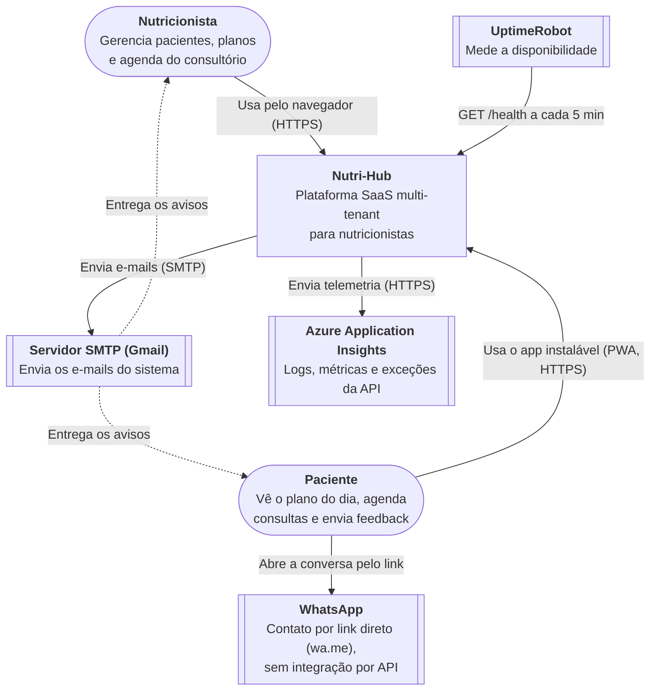
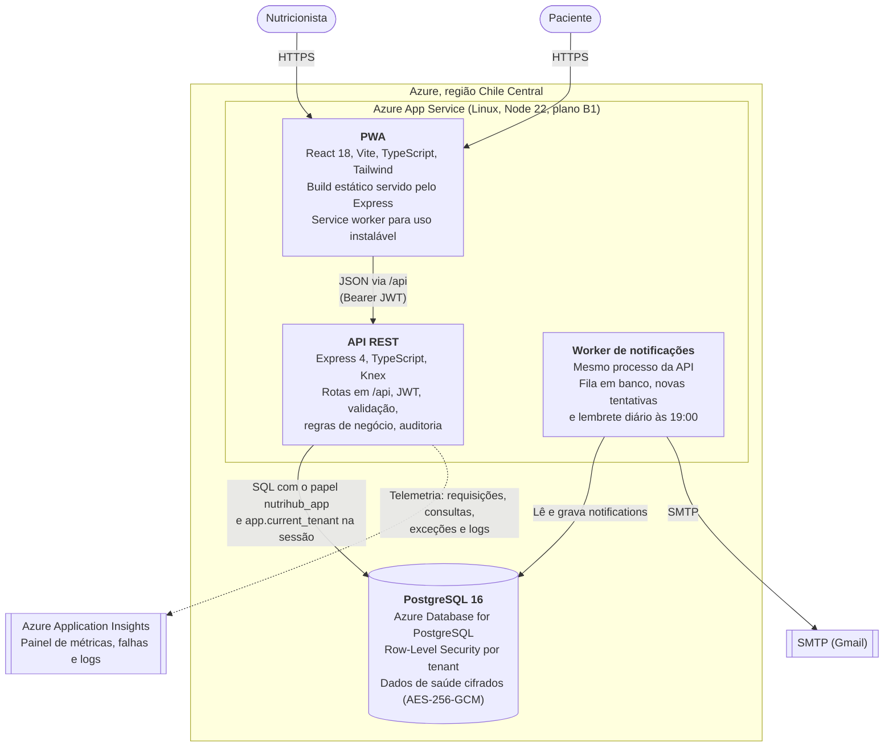
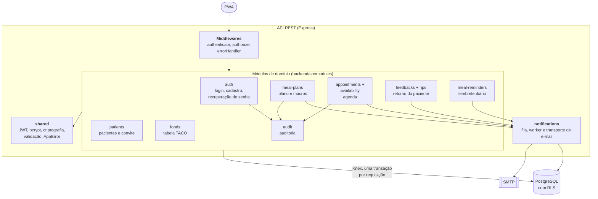
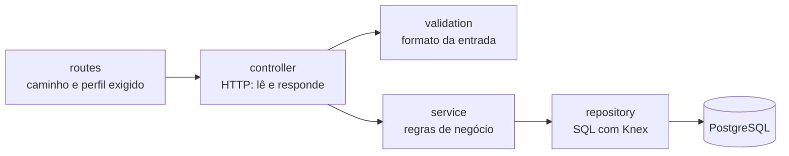

# Arquitetura do Nutri-Hub (modelo C4)

Versão para leitura na Wiki; a fonte versionada fica em `docs/ARQUITETURA.md`. Os diagramas seguem o [modelo C4](https://c4model.com), em três níveis: contexto, contêiner e componente. Estão em Mermaid, então o GitHub os desenha direto no navegador e a fonte fica versionada junto com o código.

Eles mostram o sistema **como foi implementado**. O RFC (seção 5) previa o frontend no Azure Static Web Apps, que não existe nas regiões permitidas pela assinatura. Os motivos estão em [Mudanças em relação ao RFC](Decisoes-de-engenharia).

## Nível 1: contexto

Quem usa o sistema e com o que ele conversa.

## Nível 2: contêineres

Os blocos que rodam e o que cada um guarda ou executa. A API, o worker de notificações e o PWA compilado saem do **mesmo processo Node**, no mesmo endereço, e por isso não há CORS.

Decisões que aparecem no diagrama:

| Decisão | Motivo |
|---|---|
| Monolito modular em vez de microsserviços | Um desenvolvedor e um domínio só. Os módulos têm fronteiras claras e podem ser separados depois |
| Isolamento por RLS no banco | O isolamento entre consultórios vale mesmo que a aplicação erre uma consulta (RNF-01) |
| A API conecta com um papel sem privilégio de dono | Um papel dono das tabelas ignoraria o RLS |
| Application Insights no próprio processo | Observabilidade sem montar Prometheus e Grafana. Plano gratuito, e a API segue funcionando se o coletor estiver desligado |
| Worker no mesmo processo | Evita um segundo serviço pago. A fila fica no banco, então um reinício não perde envios |
| PWA servido pela API | Sem CORS e sem Static Web Apps, que não existe nas regiões permitidas |

## Nível 3: componentes da API

Cada módulo de `backend/src/modules` segue as mesmas camadas: rotas, controller, service, repository e validação.

## Camadas dentro de um módulo

O controller não conhece SQL, o repository não conhece HTTP, e as regras de negócio ficam só no service. É isso que permite testar o service com o repository simulado (testes unitários) e o conjunto contra um Postgres de verdade (testes de integração).
